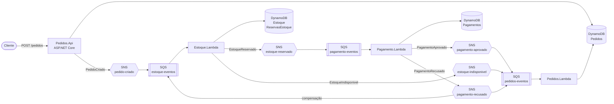
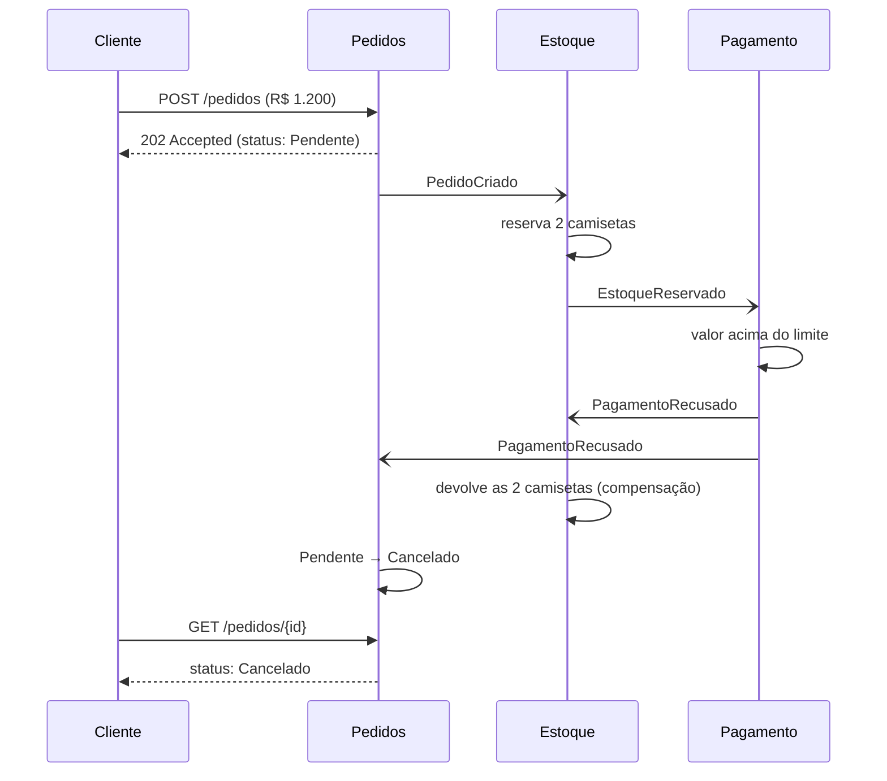

# Loja Eventos

Sistema de pedidos de e-commerce construído com **microsserviços orientados a eventos na AWS**, em **.NET 10**.

Um pedido atravessa três serviços independentes (Pedidos, Estoque e Pagamento) que se comunicam apenas por eventos. Quando algo falha no meio do caminho, os serviços desfazem o que já tinham feito, sem nenhuma transação distribuída: é uma **saga coreografada com compensação**.

> Projeto de estudo, construído para praticar na AWS os conceitos de arquitetura distribuída: mensageria, consistência eventual, idempotência, concorrência e tratamento de falhas.

---

## Arquitetura



Cada serviço tem **sua própria fila SQS**, inscrita nos tópicos SNS que interessam a ele (padrão *fan-out*), e **cada fila tem sua DLQ**.

### O caminho de um pedido recusado



Log real dessa execução, filtrado pelo `correlationId` nos três serviços:

```
09:23:06.017  estoque-reservar          Reservando estoque do pedido 531e7660...
09:23:06.957  estoque-reservar          Estoque reservado.
09:23:08.824  pagamento-cobrar          Pagamento de R$ 1,200.00 recusado.
09:23:09.137  estoque-reservar          Estoque devolvido (Limite do cartão excedido).
09:23:10.822  pedidos-atualizar-status  PagamentoRecusado: Pendente -> Cancelado
```

---

## Serviços

| Serviço | Responsabilidade | Escuta | Publica | Dados |
|---|---|---|---|---|
| **Pedidos** (API) | Recebe e consulta pedidos | HTTP | `PedidoCriado` | `Pedidos` |
| **Pedidos** (Lambda) | Atualiza o status do pedido | `EstoqueIndisponivel`, `PagamentoAprovado`, `PagamentoRecusado` | - | `Pedidos` |
| **Estoque** (API) | Lista produtos para a vitrine (`GET /produtos`), só leitura | HTTP | - | `Estoque` |
| **Estoque** (Lambda) | Reserva produtos e devolve na compensação | `PedidoCriado`, `PagamentoRecusado` | `EstoqueReservado`, `EstoqueIndisponivel` | `Estoque`, `ReservasEstoque` |
| **Pagamento** | Cobra o cliente (simulado: recusa acima de R$ 1.000) | `EstoqueReservado` | `PagamentoAprovado`, `PagamentoRecusado` | `Pagamentos` |

Nenhum serviço lê a tabela de outro. O que cada um precisa chega no evento.

---

## Decisões técnicas

### Comunicação assíncrona com SNS + SQS
O SNS distribui o evento para todos os interessados, e a SQS guarda a mensagem até o serviço processar. Se um serviço estiver fora do ar, as mensagens esperam na fila dele, e os outros seguem normalmente. O produtor não conhece os consumidores: para adicionar um novo serviço, basta inscrever uma fila no tópico.

### Idempotência em todos os consumidores
A SQS padrão entrega **pelo menos uma vez**, então a mesma mensagem pode chegar repetida. Cada serviço grava um registro com escrita condicional (`attribute_not_exists`):
- **Estoque:** a reserva do pedido. Uma mensagem repetida não baixa o estoque de novo ([Function.cs](src/Estoque/Estoque.Lambda/Function.cs)).
- **Pagamento:** o pagamento do pedido. Uma mensagem repetida não cobra o cliente de novo ([Function.cs](src/Pagamento/Pagamento.Lambda/Function.cs)).
- **Pedidos:** as transições de status são idempotentes no domínio. Confirmar um pedido já confirmado não faz nada ([Pedido.cs](src/Pedidos/Pedidos.Domain/Pedido.cs)).

Ao detectar uma repetição, o serviço **republica** o resultado em vez de ignorar: a execução anterior pode ter caído depois de gravar e antes de publicar.

### Baixa de estoque sem condição de corrida
A Lambda escala em várias instâncias paralelas. Ler o estoque e depois gravar em passos separados permitiria vender a mesma unidade duas vezes. A baixa é uma **escrita condicional atômica** (`Quantidade >= :necessaria`), e o próprio DynamoDB garante que só uma passa.

### Reserva "tudo ou nada"
Registro da reserva e baixa de todos os produtos acontecem numa única `TransactWriteItems`. Se faltar um produto, nada é baixado, e o serviço identifica exatamente qual faltou.

### Saga coreografada com compensação
Não existe transação entre serviços. Quando o pagamento é recusado, o Estoque recebe o mesmo evento que o Pedidos e **desfaz a própria reserva**. A devolução também é idempotente: a reserva muda de `Ativa` para `Devolvida` com escrita condicional.

### Falhas isoladas com DLQ e resposta parcial de lote
Mensagens que falham voltam para a fila e, depois de 3 tentativas, vão para a DLQ. As Lambdas usam `ReportBatchItemFailures`: uma mensagem com problema não obriga a reprocessar as outras do mesmo lote ([ProcessadorLote.cs](src/Mensageria/ProcessadorLote.cs)).

### Contratos de evento estáveis
Todos os eventos usam o mesmo envelope ([EventEnvelope.cs](src/Contracts/EventEnvelope.cs)):

| Campo | Para que serve |
|---|---|
| `eventId` | Identificador único do evento |
| `eventType` | Roteamento no consumidor |
| `version` | Evoluir o contrato sem quebrar consumidores |
| `correlationId` | Rastrear um pedido nos logs de todos os serviços |

Os eventos **não reutilizam as classes do domínio**: o domínio pode mudar sem quebrar quem consome.

### Clean Architecture / Hexagonal no serviço de Pedidos
O `Domain` não depende de nada, nem da AWS. Ele define as portas (`IPedidoRepository`, `IEventPublisher`), e a `Infrastructure` implementa com DynamoDB e SNS. A API e a Lambda são dois pontos de entrada para o mesmo domínio.

### Modelagem no DynamoDB pelos padrões de acesso
O pedido e seus itens formam um agregado (DDD) e ficam **num único item** da tabela, com os itens como lista. Uma leitura traz tudo, e a gravação é atômica.

### Segurança
- Credenciais nunca ficam no código: localmente vêm do `aws configure`; na AWS, das roles do IAM.
- **Uma role por função**, com o mínimo necessário. A Lambda de Pedidos, por exemplo, não tem permissão para publicar no SNS.
- Cada fila só aceita mensagens dos tópicos SNS que lhe interessam.

---

## Estrutura

```
src/
├── Contracts/           Eventos e envelope (o "idioma" entre os serviços)
├── Mensageria/          Leitura de mensagens SNS/SQS, publicação e processamento de lote
├── Pedidos/
│   ├── Pedidos.Domain/          Pedido, ItemPedido, regras e portas
│   ├── Pedidos.Infrastructure/  DynamoDB e SNS (adaptadores)
│   ├── Pedidos.Api/             POST e GET /pedidos
│   └── Pedidos.Lambda/          Atualiza status a partir dos eventos
├── Estoque/
│   ├── Estoque.Api/             GET /produtos (vitrine)
│   └── Estoque.Lambda/          Reserva e compensação
└── Pagamento/Pagamento.Lambda/  Cobrança simulada
```

## Stack

- **.NET 10**, C#, ASP.NET Core (Minimal APIs)
- **AWS Lambda** (runtime `dotnet10`), **SNS**, **SQS** com DLQ, **DynamoDB**, **IAM**, **CloudWatch Logs**
- AWS SDK for .NET, Amazon.Lambda.Tools

---

## Como executar

### Pré-requisitos
- .NET 10 SDK
- AWS CLI configurada (`aws configure`) com um usuário IAM, nunca o root
- `dotnet tool install -g Amazon.Lambda.Tools`

### Recursos na AWS
| Tipo | Nomes |
|---|---|
| Tabelas DynamoDB | `Pedidos`, `Estoque`, `ReservasEstoque`, `Pagamentos` (chave de partição: `PedidoId` ou `ProdutoId`) |
| Tópicos SNS | `pedido-criado`, `estoque-reservado`, `estoque-indisponivel`, `pagamento-aprovado`, `pagamento-recusado` |
| Filas SQS (cada uma com `-dlq`) | `estoque-eventos`, `pagamento-eventos`, `pedidos-eventos` |
| Roles IAM | uma por Lambda |

A configuração usa só **nomes** de tópicos e roles (`appsettings.json` e os `aws-lambda-tools-defaults.json` de cada Lambda). O ARN dos tópicos é montado em tempo de execução, descobrindo a conta com `sts:GetCallerIdentity`, então o repositório não contém o ID da conta AWS ([PublicadorSns.cs](src/Mensageria/PublicadorSns.cs)).

### Publicar uma Lambda
```bash
cd src/Estoque/Estoque.Lambda
dotnet lambda deploy-function
```

### Rodar a API localmente
```bash
dotnet run --project src/Pedidos/Pedidos.Api
```
Exemplos de requisição em [Pedidos.Api.http](src/Pedidos/Pedidos.Api/Pedidos.Api.http).

As duas APIs (Pedidos e Estoque) também rodam como **Lambda atrás de uma Function URL**, com o mesmo código: o pacote `Amazon.Lambda.AspNetCoreServer.Hosting` traduz o evento da Lambda em uma requisição ASP.NET Core comum. Rodando local, ele não faz nada e o Kestrel atende. Para tráfego baixo, o custo fica dentro da cota gratuita.

### Front-end
A vitrine com carrinho fica no repositório irmão `loja-eventos-web` (React + Vite + TypeScript). Ela lista os produtos pela API do Estoque, envia pedidos para a API de Pedidos e acompanha o status mudando de `Pendente` para `Confirmado` ou `Cancelado`.

### Cenários para testar
| Pedido | Resultado esperado |
|---|---|
| Valor até R$ 1.000, com estoque | `Confirmado` |
| Valor acima de R$ 1.000 | `Cancelado`, e o estoque reservado é devolvido |
| Quantidade maior que o estoque | `Cancelado`, e nada é baixado |
| Sem itens ou com quantidade zero | `400 Bad Request` |

---

## Limitações conhecidas

Simplificações conscientes, e o que eu faria num sistema em produção:

| Limitação | Evolução |
|---|---|
| **Escrita dupla na API:** se ela cair entre salvar o pedido e publicar o evento, o evento se perde | **Outbox** com DynamoDB Streams: a API só grava, e uma Lambda publica a partir do stream |
| O preço do item vem do cliente | Consultar o preço num serviço de catálogo |
| As APIs são públicas, sem autenticação (Function URL com `AuthType NONE`) | Autenticação com Cognito, ou API Gateway com autorizador e limite de requisições |
| A atualização de status do pedido grava o item inteiro (a última escrita vence) | Controle de concorrência otimista, com um campo de versão |
| `Contracts` e `Mensageria` são compartilhados entre os serviços | Pacotes NuGet versionados ou um schema registry |
| Infraestrutura criada pelo console e por script | Infraestrutura como código (AWS SAM ou CDK) |
| Sem testes automatizados nem pipeline | Testes de domínio, CI/CD por serviço |

## Próximos passos

- [ ] Serviço de Notificação reagindo a `PedidoConfirmado` e `PedidoCancelado`
- [ ] Outbox com DynamoDB Streams
- [ ] Infraestrutura como código
- [x] Front-end com listagem de produtos e carrinho (`loja-eventos-web`)
- [ ] Testes automatizados e pipeline de CI/CD
